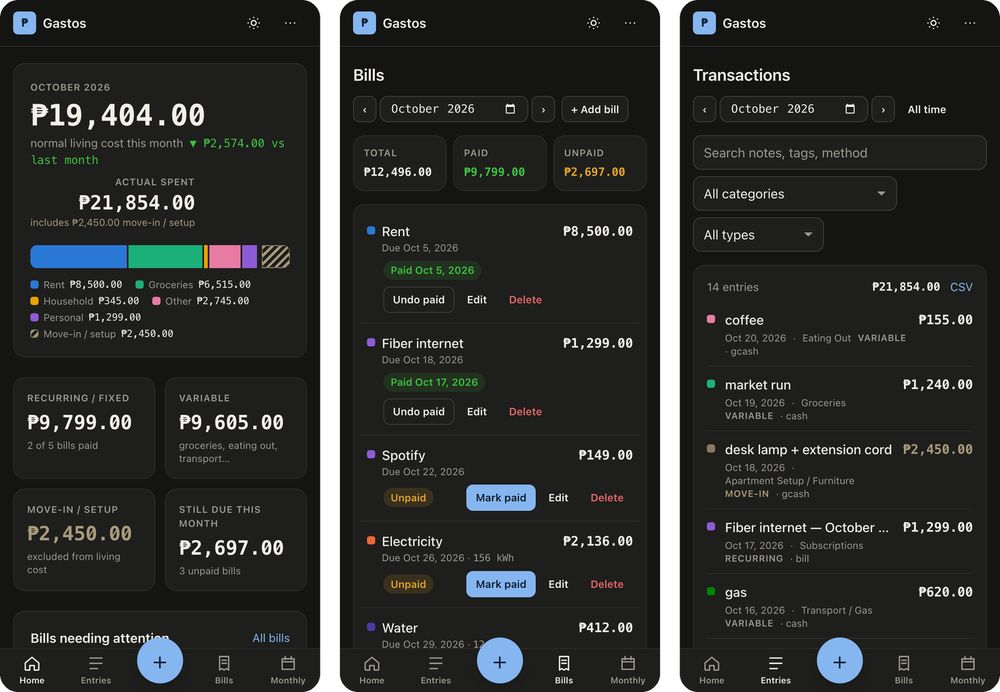

# Gastos

Not a basic budget tracker, but a basic AI budget tracker, minus sending it to anyone's database.

It's a self-hosted expense and bills tracker for one person. You log what you spend, keep track of rent, utilities and other bills, and see where the month went. You can paste a receipt or a quick note like `bigas 5kg 310, joy 89, pamasahe 30` and the AI splits it into entries for you to check before saving. There's also an Ask page where you can chat about your money. It sees your live numbers and keeps a small memory of balances, goals and rules that you can edit yourself.

Everything lives in one SQLite file in `./data`, with daily snapshots in `./data/backups`. The only thing that leaves your server is the prompt sent to whatever AI API you point it at, and you can turn that off.

Amounts are in pesos and dates are Asia/Manila. Built with Next.js, Drizzle and better-sqlite3.



## Run it

```bash
cp .env.example .env
# set APP_PASSWORD and SESSION_SECRET (openssl rand -hex 32)
docker compose up -d --build
```

Then open `http://<host>:3000`. The first start runs the migrations and adds a starter set of categories. Everything else is empty until you add it.

For local dev, `npm install` then `npm run dev`.

## Env vars

| Var | Default | What it does |
|---|---|---|
| `PORT` | `3000` | Host port |
| `APP_PASSWORD` | empty (no login) | Password for the lock screen. Set it if the app is reachable from the internet |
| `SESSION_SECRET` | empty | Signs the session cookie |
| `BACKUP_KEEP` | `14` | Daily snapshots to keep |
| `BACKUP_HOUR` | `3` | Hour the daily snapshot is written |
| `AI_API_KEY` | empty (AI off) | Key for the chat API |
| `AI_BASE_URL` | `https://api.deepseek.com` | Any OpenAI-compatible endpoint |
| `AI_MODEL` | `deepseek-v4-pro` | Model name |
| `AI_IMAGES` | `false` | `true` only if the model reads images. Shows the attach button on Ask |
| `OWNER_NAME`, `OWNER_ABOUT` | empty | Your name and a line about you, passed to the Ask advisor |
| `MCP_TOKEN` | empty (off) | Turns on an MCP endpoint at `/api/mcp/<token>` for your own AI client |
| `API_TOKEN` | empty (off) | Bearer token for the read-only `/api/bills/upcoming` |

## AI

Receipt parsing and Ask both call an OpenAI-compatible chat API from the server in JSON mode. It defaults to DeepSeek, but any endpoint that speaks the same API works. Leave `AI_API_KEY` empty and both features are hidden.

If your AI client runs in another Docker network and needs to reach the MCP endpoint, put that network in a `docker-compose.override.yml`. It's gitignored.

## Backups

The app snapshots the database once a day. `./scripts/backup.sh` takes one on demand and `./scripts/restore.sh <file>` swaps one back in. You can also export or restore JSON from Reports. `deploy.sh` ships the committed tree to a server over ssh if you set `GASTOS_HOST`.

## License

MIT
